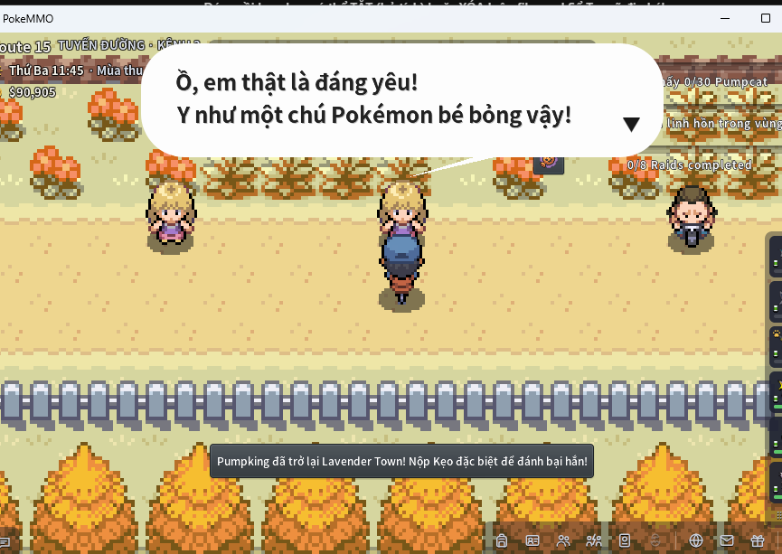
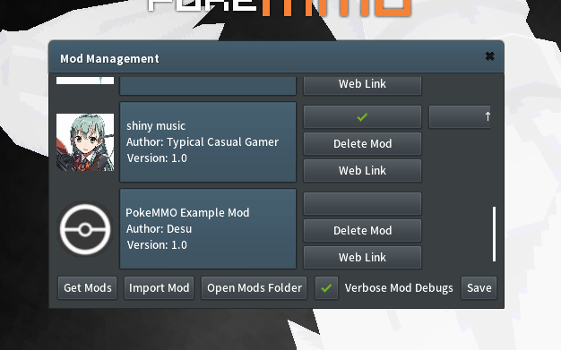

# 🌟 PokeMMO Việt Hóa Hoàn Chỉnh 5 Vùng (PC, Android & iOS)

[](https://pokemmo.com)
[](https://github.com/NguyenTheVy/PokeMMO-Viet-Hoa/)
[](https://github.com/NguyenTheVy/PokeMMO-Viet-Hoa/)
[-red.svg)](https://github.com/NguyenTheVy/PokeMMO-Viet-Hoa/)
[](https://github.com/NguyenTheVy/PokeMMO-Viet-Hoa/)

Bản Mod Việt Hóa toàn diện, trau chuốt và chuẩn ngữ cảnh dành cho cộng đồng người chơi **PokeMMO Việt Nam**. Hỗ trợ đầy đủ cả **5 Đại Lục** (Kanto, Johto, Hoenn, Sinnoh, Unova), đi kèm bộ **Font Pixel Tiếng Việt độc quyền**.

---

## ⚡ LỰA CHỌN PHIÊN BẢN PHÙ HỢP VỚI BẠN

Dự án hiện cung cấp **2 phiên bản riêng biệt** để người chơi tùy chọn theo phong cách trải nghiệm:

| Tính Năng | 📖 Bản Tiêu Chuẩn (Standard) | ⚡ Bản Siêu Tốc (Speed / Rush) |
| :--- | :---: | :---: |
| **Dịch 100% cốt truyện 5 đại lục** |  Có |  Có |
| **Bộ Font Pixel retro không lỗi dấu** |  Có |  Có |
| **Hội thoại NPC đầy đủ nguyên bản** |  Có (Đầy đủ 100%) |  Có (Giữ cốt truyện chính) |
| **Bỏ qua thoại Y tá Joy (Hồi máu tức thì)** | ❌ Không |  **Tự động hồi máu ngay** |
| **Hội thoại dùng HM / TM (Surf, Cut, Smash...)** | 📖 Đầy đủ câu thoại & xác nhận |  **Rút gọn tối đa (bấm qua nhanh)** |
| **Hiển thị bảng tiền thưởng Gym / Cooldown** | ❌ Không |  **Có bảng tính tiền & giờ chờ** |
| **Thoát trận tức thì khi thắng Gym Rerun** | ❌ Bấm phím qua thoại |  **Thoát trận ngay lập tức** |
| **Kích thước nút bấm (Yes / No)** |  Nhỏ gọn chuẩn gốc |  Nhỏ gọn chuẩn gốc (Không bị to) |
| **Đối tượng phù hợp** | Người mới chơi, thích đọc cốt truyện | Game thủ cày cuốc, Gym Rerun, Rush map |

---

## 📑 Mục Lục
- [📥 Tải Về](#-tải-về)
- [🌟 Điểm Nổi Bật](#-điểm-nổi-bật)
- [📸 Hình Ảnh Trải Nghiệm](#-hình-ảnh-trải-nghiệm)
- [🛠 Hướng Dẫn Cài Đặt](#-hướng-dẫn-cài-đặt)
  - [Cài đặt trên PC (Windows / macOS / Linux)](#1-cài-đặt-trên-pc-windows--macos--linux)
  - [Cài đặt trên Android](#2-cài-đặt-trên-android)
  - [Cài đặt trên iOS (iPhone / iPad)](#3-cài-đặt-trên-ios-iphone--ipad)
  - [⚙️ Thiết lập trong Game (Bắt buộc)](#4-️-thiết-lập-trong-game-bắt-buộc)
- [❓ Câu Hỏi Thường Gặp (FAQ)](#-câu-hỏi-thường-gặp-faq)
- [🤝 Lời Cảm Ơn & Đóng Góp](#-lời-cảm-ơn--đóng-góp)

---

## 📥 Tải Về

Tải file mod phiên bản phù hợp tại mục [**Releases**](https://github.com/NguyenTheVy/PokeMMO-Viet-Hoa/releases):

| Phiên Bản | Tên File Mod | Nhu Cầu Sử Dụng | Nền Tảng Hỗ Trợ | Dung Lượng |
| :--- | :--- | :--- | :--- | :--- |
| **Bản Siêu Tốc (Speed / Rush)** | `PokeMMO-VietHoa-SupersStoryStrings-v1.3.6.1.zip` *(hoặc `.mod`)* | Cày cuốc, Gym Rerun, rút gọn thoại HM/TM, hồi máu tức thì | PC, Android, iOS | ~10.5 MB |
| **Bản Tiêu Chuẩn (Standard)** | `PokeMMO-Viet-Hoa-08-Fix5.mod` | Trải nghiệm trọn vẹn từng câu thoại cốt truyện gốc | PC, Android, iOS | ~9.3 MB |

> 💡 **Mẹo:** Bạn chỉ cần tải **1 trong 2 bản** tùy theo nhu cầu (định dạng `.zip` hoặc `.mod` đều import trực tiếp vào game được ngay, không cần giải nén).

---

## 🌟 Điểm Nổi Bật

### 1. 🇻🇳 Việt Hóa Toàn Diện 5 Đại Lục
- Dịch hoàn chỉnh cốt truyện, chuỗi nhiệm vụ và hội thoại NPC tại **Kanto, Johto, Hoenn, Sinnoh, Unova**.
- Giao diện người dùng (UI), Cài đặt, Bảng thông số Pokémon, Túi đồ (Bag), Chợ GTL (Global Trade Link) đều được trau chuốt tỉ mỉ.
- Chuẩn hóa hệ thống chiêu thức (Moves), chỉ số, hiệu ứng, vật phẩm quen thuộc với cộng đồng Pokémon.

### 2. 🎯 Tinh Chỉnh Ngữ Cảnh Tự Nhiên
- Khắc phục triệt để các câu từ dịch thô/dịch máy ngô nghê của các bản cũ.
- Chuẩn hóa danh xưng nhân vật, đại từ xưng hô phù hợp từng độ tuổi, vai vế và diễn biến cảm xúc trong game.
- Bảo đảm 100% các biến hệ thống (`{PLAYER}`, `{STR_VAR_1}`, tên chỉ số) hiển thị chính xác, không tràn khung hội thoại.

### 3. 🔤 Bộ Font Pixel Tiếng Việt Độc Quyền (Không Lỗi Font)
- Tích hợp sẵn font Pixel Việt hóa riêng biệt: **hiển thị đầy đủ dấu tiếng Việt**, sắc nét từng điểm ảnh, chuẩn phong cách retro của Pokémon gốc.
- Không bị lỗi ô vuông, không bị mất dấu hay nhòe chữ khi chơi ở độ phân giải cao.
- Đi kèm 2 Theme tối ưu:
  - **`Viet PC Pixel 08`**: Tối ưu hiển thị cho PC, màn hình rộng và tỷ lệ cửa sổ linh hoạt.
  - **`Viet Android Pixel 08`**: Tối ưu cỡ chữ to rõ, dễ đọc cho màn hình cảm ứng điện thoại.
 
### 4. 📦 Đóng Gói Tiện Lợi (Single File .zip / .mod)
- Đóng gói duy nhất 1 file hoàn chỉnh (chuẩn `string_revision="1"` tương thích 100% với PokeMMO Client hiện tại).
- Không cần giải nén, chỉ cần import trực tiếp file `.zip` hoặc `.mod` là chơi ngay, không lo xung đột hay ghi đè file hệ thống.

---

## 📸 Hình Ảnh Trải Nghiệm

| Hội thoại trong game | Quản lý Mod trong PokeMMO |
| :---: | :---: |
|  |  |
| *Hội thoại tiếng Việt hiển thị mượt mà, đúng ngữ cảnh* | *Mod được nhận diện hoàn hảo trong mục Mod Management* |

---

## 🛠 Hướng Dẫn Cài Đặt

### 1. Cài đặt trên PC (Windows / macOS / Linux)

#### Cách 1: Sử dụng tính năng Import của Game (Khuyên dùng)
1. Khởi động **PokeMMO**.
2. Tại màn hình Đăng Nhập, nhấn vào nút **Mod Management** (Quản lý Mod) ở góc phải dưới.
3. Nhấn **Import Mod** và chọn file mod bạn đã tải về (`PokeMMO-VietHoa-SupersStoryStrings-v1.3.6.1.zip` hoặc `PokeMMO-Viet-Hoa-08-Fix5.mod`).
4. Tích chọn ô vuông bên cạnh mod để kích hoạt (hiện dấu tích xanh ✅).
5. Nhấn **Save** và khởi động lại game.

#### Cách 2: Chép trực tiếp vào thư mục mods
- **Windows**: Chép file `.zip` hoặc `.mod` vào thư mục:
  ```
  PokeMMO/data/mods/
  ```
  *(Ví dụ: `C:\Program Files\PokeMMO\data\mods\` hoặc `D:\PokeMMO\data\mods\`)*
- **macOS**: Click chuột phải vào `PokeMMO.app` -> *Show Package Contents* -> `Contents/Resources/Java/data/mods/`.
- **Linux**: Chép vào thư mục `pokemmo/data/mods/`.

---

### 2. Cài đặt trên Android

1. Tải file mod (Bản Siêu Tốc `PokeMMO-VietHoa-SupersStoryStrings-v1.3.6.1.zip` hoặc Bản Tiêu Chuẩn `PokeMMO-Viet-Hoa-08-Fix5.mod`) trực tiếp về điện thoại (file sẽ nằm trong thư mục `Download`).
2. Mở ứng dụng **PokeMMO** trên điện thoại.
3. Tại màn hình Đăng nhập (Login), nhấn vào biểu tượng **Menu bánh răng ⚙️** (hoặc nút **Mod Management**).
4. Chọn **Import Mod** -> tìm và chọn file vừa tải trong thư mục `Download`.
5. Đánh dấu tích xanh ✅ vào mod tiếng Việt vừa import.
6. Chọn **Save** và nhấn **Restart Game** khi có thông báo.

---

### 3. Cài đặt trên iOS (iPhone / iPad)

1. Dùng trình duyệt Safari tải file mod về máy -> Lưu tệp vào ứng dụng **Tệp (Files)** của iPhone/iPad (thường nằm trong mục *Tải về*).
2. Mở ứng dụng **PokeMMO** trên iPhone/iPad (ở màn hình Đăng nhập Login).
3. Nhấn vào biểu tượng **Menu bánh răng ⚙️** (hoặc nút **Mod Management**).
4. Chọn **Import Mod** -> trình duyệt **Tệp (Files)** của iOS sẽ tự động mở lên -> chọn file mod vừa tải về.
5. Đánh dấu tích xanh ✅ kích hoạt mod.
6. Chọn **Save** và nhấn **Restart Game** khi có thông báo.

---

### 4. ⚙️ Thiết lập trong Game (Bắt buộc)

Để game hiển thị tiếng Việt chuẩn 100%, bạn cần kiểm tra cài đặt sau:

1. **Ngôn ngữ Game (Language):**
   - Vào **Cài đặt (Settings)** -> **Ngôn ngữ (Language)** -> Chọn **English** (Bản mod sử dụng slot ngôn ngữ tiếng Anh để đảm bảo độ tương thích cao nhất).
   - Lưu lại và khởi động lại game để áp dụng.

---

## ❓ Câu Hỏi Thường Gặp (FAQ)

<details>
<summary><b>1. Tôi nên chọn Bản Tiêu Chuẩn hay Bản Siêu Tốc?</b></summary>
<p>
- Nếu bạn là <b>người mới chơi</b> hoặc muốn thưởng thức cốt truyện trọn vẹn: Chọn <b>Bản Tiêu Chuẩn</b> (<code>PokeMMO-Viet-Hoa-08-Fix5.mod</code>).<br>
- Nếu bạn <b>đã qua cốt truyện</b>, muốn cày cấp, đi Gym Rerun hoặc muốn di chuyển nhanh (rút gọn tối đa hội thoại HM/TM khi Surf, Cut... để bấm qua nhanh, hồi máu PokeCenter ngay lập tức): Chọn <b>Bản Siêu Tốc</b> (<code>PokeMMO-VietHoa-SupersStoryStrings-v1.3.6.1.zip</code>).
</p>
</details>

<details>
<summary><b>2. Tôi cài mod vào nhưng trong game vẫn hiện tiếng Anh?</b></summary>
<p>Hãy kiểm tra lại xem trong <b>Mod Management</b> bạn đã đánh dấu tích xanh ✅ cạnh tên mod chưa, và đảm bảo mục Language trong Settings đang đặt là <b>English</b>.</p>
</details>

<details>
<summary><b>3. Chữ tiếng Việt bị ô vuông hoặc mất dấu phải làm sao?</b></summary>
<p>Bạn hãy vào <b>Settings -> Interface -> Theme</b> và chọn đúng <code>Viet PC Pixel 08</code> (trên PC) hoặc <code>Viet Android Pixel 08</code> (trên điện thoại Android/iOS) để kích hoạt font chữ Pixel có dấu.</p>
</details>

<details>
<summary><b>4. Mod này có dùng chung được với mod Nhạc (Music) hay mod Hình ảnh (Sprites/HD Items) không?</b></summary>
<p><b>Hoàn toàn tương thích!</b> Mod Việt hóa chỉ can thiệp vào chuỗi văn bản (strings) và giao diện chữ (theme/font), hoàn toàn không ảnh hưởng tới mod RealCries, Follower Sprites, Shiny Audio hay HD Items. Bạn có thể bật đồng thời bình thường.</p>
</details>

<details>
<summary><b>5. Tôi có bị khóa tài khoản (Ban) khi sử dụng mod Việt Hóa không?</b></summary>
<p><b>Không!</b> PokeMMO có hệ thống hỗ trợ Mod chính thức thông qua tính năng <i>Mod Management</i> và thư mục <code>data/mods/</code> được quy định rõ trong điều khoản của PokeMMO. Bản mod tuân thủ 100% chuẩn định dạng của nhà phát hành.</p>
</details>

---

## 🤝 Lời Cảm Ơn & Đóng Góp

- Dự án được kế thừa và phát triển từ tâm huyết của cộng đồng người hâm mộ Pokémon Việt Nam qua các thời kỳ và sự đóng góp của cộng đồng SuperStrings (superworldsun).
- Đóng góp báo lỗi dịch thuật hoặc gợi ý chỉnh sửa: Bạn có thể tạo **Issue** trên GitHub hoặc gửi bình luận phản hồi.

---

<p align="center">Chúc bạn có những chuyến phiêu lưu tuyệt vời và trở thành Pokémon Champion trong thế giới PokeMMO! 🏆</p>
